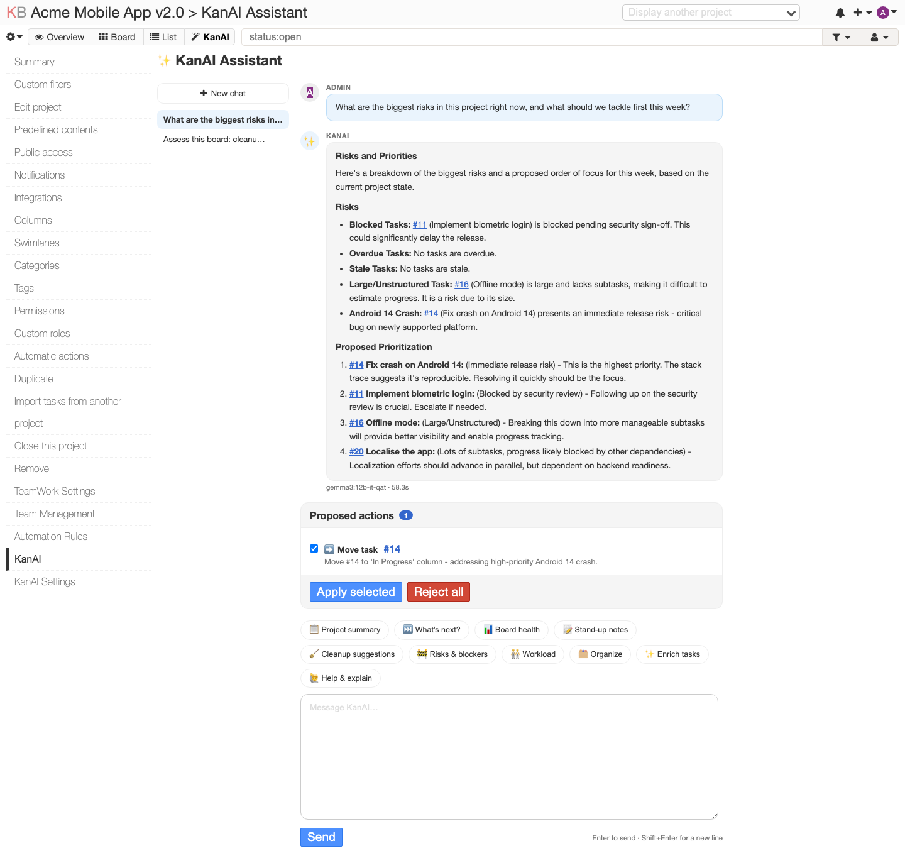
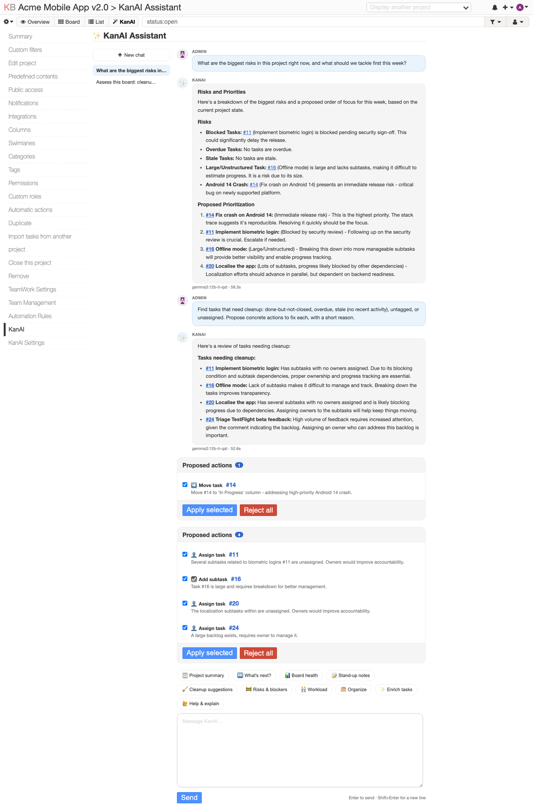
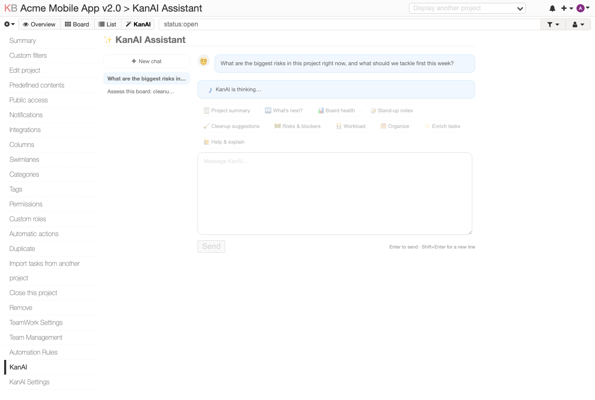
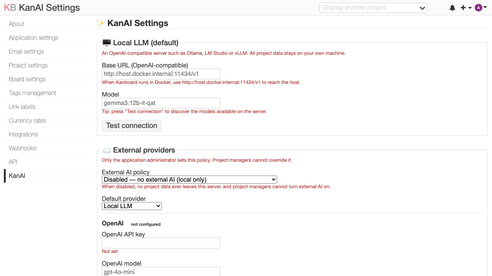
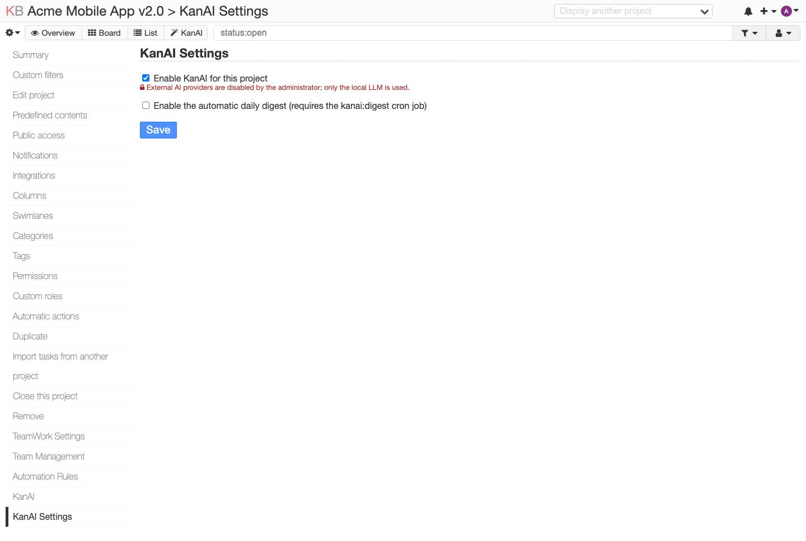

# KanAI — AI assistant & project Q&A for Kanboard

KanAI connects a Kanboard instance to an LLM. It works **fully on a local LLM**
(Ollama / LM Studio / vLLM / any OpenAI-compatible server) and can **optionally**
use external providers (Anthropic Claude, OpenAI). An administrator can switch
all external AI off with a single, server-enforced kill switch — by default no
project data ever leaves your server.

Questions are processed **in the background**: the page responds instantly, a
thinking indicator polls for the result, and the answer appears when ready.
That means **no web-server timeouts and no practical limit on model size** —
a 7B model that answers in 3 seconds and a 70B model that takes 5 minutes both
just work.

## Features

### 💬 Shared chat per project
A **KanAI tab** next to Overview / Board / List opens a chat panel with multiple
conversations (create, rename, delete). Conversations are shared with every
project member, so a colleague can pick up where you left off; each message
shows the sender's avatar and name. Messages send without a page reload
(Enter to send, Shift+Enter for a new line), answers render as Markdown, task
references like `#9` become clickable links, and each answer shows which model
produced it and how long it took.

### 🤖 Assistant with human approval
Ask KanAI to tidy the board and it **proposes** maintenance actions — it never
applies anything on its own. You review the proposals, tick the ones you want,
and they are applied through Kanboard's own models as *your* user, so
permissions, validations and activity streams all work normally.

Whitelisted actions (anything else the model suggests is rejected):

| Action | | Action | |
|---|---|---|---|
| `create_task` | ➕ create a task | `assign_task` | 👤 set the owner |
| `update_task` | ✏️ improve title/description | `add_tag` | 🏷️ add tags |
| `close_task` | ✅ close | `set_due_date` | 📅 set a due date |
| `reopen_task` | ↩️ reopen | `add_comment` | 💬 add a comment |
| `move_task` | ➡️ move to a column | `add_subtask` | ☑️ add a subtask |
| `link_tasks` | 🔗 relate two tasks | | |

### ⚡ Quick actions
One-click presets above the composer:

📋 Project summary · ⏭️ What's next? · 📊 Board health · 📝 Stand-up notes ·
🧹 Cleanup suggestions · 🚧 Risks & blockers · 🧑‍🤝‍🧑 Workload · 🗂️ Organize ·
✨ Enrich tasks · 🙋 Help & explain

### 🚀 Background processing (works with any model size)
Asking a question enqueues a job and spawns a detached CLI worker; the browser
polls until the answer is ready. The web request itself returns in
milliseconds, so slow models can't cause 504 Gateway Timeouts and Kanboard
stays fully responsive while the model thinks. Reloading the page mid-answer
(or opening the shared conversation as another member) shows the pending
question and picks up polling — the answer appears without a manual refresh.
If the web server can't spawn processes, KanAI transparently falls back to
in-request processing.

### 🕖 Automatic daily digest (optional)
Projects can opt in to an autonomous digest: KanAI starts a fresh conversation
with a compact status / cleanup / risks report and proposals for members to
review (rendered as "KanAI (automatic)" 🤖). Schedule it from cron:

    0 7 * * * php /path/to/kanboard/cli kanai:digest >/dev/null 2>&1

For Docker: `docker exec <container> php /var/www/app/cli kanai:digest`.

### 🔒 Security model
- **Local-first**: the default provider is your own OpenAI-compatible server.
- **Admin-controlled external policy**: only the *application* administrator
  (not project managers) sets whether external AI is allowed — `disabled`
  (local only), `project_optin` (project managers may enable it per project), or
  `all_projects` (forced on). When disabled or forced, project managers cannot
  change it; the policy is enforced server-side, not just hidden in the UI.
- **Human approval gate**: no model output ever changes project state without
  an explicit click; project content is treated as untrusted input
  (prompt-injection framing in the system prompt).
- **API keys encrypted at rest** (AES-256-GCM), masked in the UI, never sent
  to the browser.
- **Rate limiting**: questions per user per hour are capped (configurable),
  refused before any LLM call.
- CSRF-validated actions, per-project access control (members chat, managers
  configure, admins manage providers).

## Install

Copy or symlink this repository into your Kanboard `plugins/` directory as
`KanAI`:

    ln -s /absolute/path/to/KanAI <kanboard>/plugins/KanAI

For Docker, bind-mount the folder to `/var/www/app/plugins/KanAI`. Then open
**Settings → Plugins** to confirm KanAI is listed. The database migrations run
automatically.

**Requirements:** Kanboard ≥ 1.2.46, PHP ≥ 7.4 with cURL and OpenSSL, and an
LLM endpoint (e.g. [Ollama](https://ollama.com) with a ~7B model such as
`qwen2.5-coder:7b` — answers in seconds; larger models give richer answers).

**Which model?** See the [model guide](docs/MODEL-GUIDE.md) for measured
latency/quality across 7B–14B and predictions up to 80B. Short version:
`gemma3:12b` is the best quality/speed balance for live chat; a fast 7–8B model
for snappy Q&A; and as large as your hardware allows for the background digest.

## Configure

### Global (Settings → KanAI, admins)

Set the local endpoint and model, manage external providers, and tune limits.
The **Test connection** button verifies the endpoint live and — for the local
server — discovers the available models as suggestions for the model field.

| Setting | Default | |
|---|---|---|
| Base URL | `http://localhost:11434/v1` | any OpenAI-compatible server; use `http://host.docker.internal:11434/v1` from Docker |
| API key (local) | _(blank)_ | optional; set it for a local server that needs auth (LocalAI, a reverse proxy). Blank = no auth (Ollama, llama.cpp) |
| External AI policy | disabled | `disabled` / `project_optin` / `all_projects` — app-admin only |
| Max context tokens | 8000 | how much project data goes into a question |
| Max output tokens | 1024 | answer length budget |
| Request timeout | 120s | KanAI's own timeout to the model (the browser never waits on it) |
| Rate limit | 30/user/hour | 0 = unlimited; pending background jobs count too |
| History retention | forever | auto-purge idle conversations after N days |
| Background processing | on | answers computed by a detached worker; browser polls |
| PHP CLI binary | `php` | full path if `php` is not on the web server's PATH |

### Per project (project sidebar → KanAI Settings, managers)

KanAI is off per project until enabled here. Whether the "allow external AI"
checkbox appears at all is governed by the application admin's external policy
(project managers cannot enable external AI the admin has locked down). The
automatic daily digest is a separate opt-in.

### Deployment note: background worker

With background processing on (the default) the web request never waits for
the model, so **web-server timeouts don't apply** — no nginx/Apache tuning
needed. The worker is a detached `php cli kanai:process-job <id>` process; the
only requirements are that PHP's `proc_open` is not disabled and the `php`
binary is reachable (set its full path in Settings → KanAI if not).

If your hosting can't spawn processes, KanAI automatically answers in-request
instead. Only in that fallback mode does the classic advice apply: raise the
web server's FastCGI/proxy read timeout above the slowest model answer (nginx
`fastcgi_read_timeout`, Apache `ProxyTimeout`, PHP-FPM
`request_terminate_timeout`), or pick a faster model (see the
[model guide](docs/MODEL-GUIDE.md)).

### Production note: encryption key

KanAI encrypts external-provider API keys at rest. For production, set a stable
secret in your Kanboard `config.php`:

    define('KANAI_SECRET', 'a-long-random-string');

If unset, KanAI generates a per-install key and stores it in the database
(weaker, but keys are never stored in plaintext).

## How it works

Questions are answered with retrieval-augmented context: KanAI selects the
project's most relevant tasks, comments and subtasks (keyword + recency
scoring, capped by the token budget), wraps them in a clearly-delimited
data block, and asks the model for a strict JSON envelope
(`{"answer": …, "proposals": […]}`). Proposals are validated against the action
whitelist, stored, and only applied after human approval.

Under the hood, `ask` creates a row in `kanai_jobs` and spawns a detached
worker (`php cli kanai:process-job <id>`); the worker claims the job
atomically (each job runs exactly once), calls the model, writes the messages,
and marks the job done. The browser polls a lightweight read-only endpoint
until new messages appear. Stale jobs (a worker killed mid-run) age out
automatically, and finished jobs are purged after an hour.

## Development

Pure-logic classes (crypto, gating policy, LLM request/response shaping,
proposal validation, RAG helpers) are unit-tested standalone:

    php composer.phar install
    ./vendor/bin/phpunit

Design docs and build plans live in `docs/superpowers/`. Translations:
English (source) and Dutch (`Locale/nl_NL`).

## License

MIT — see [LICENSE](LICENSE).
